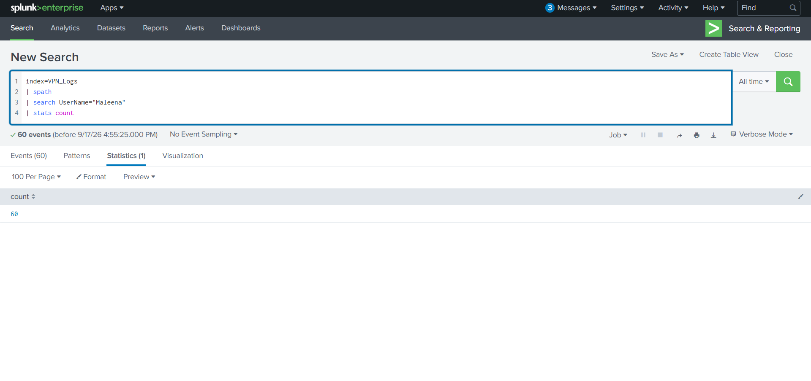
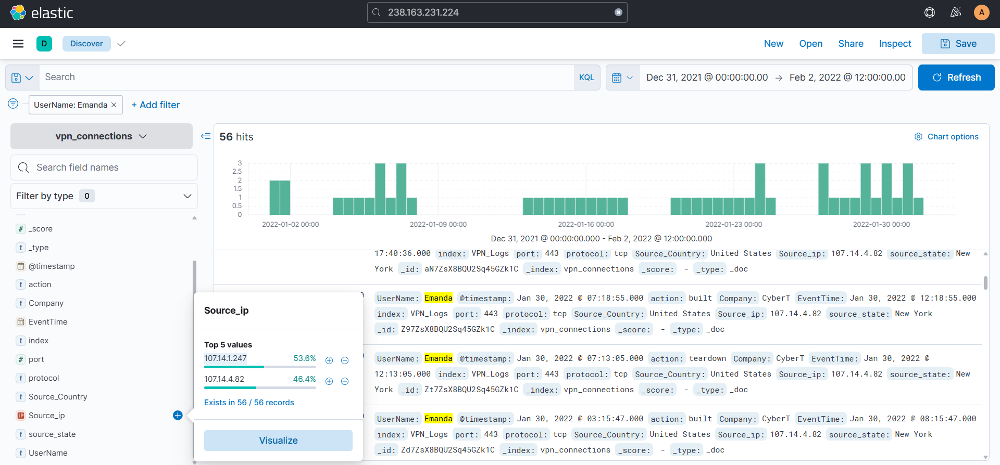
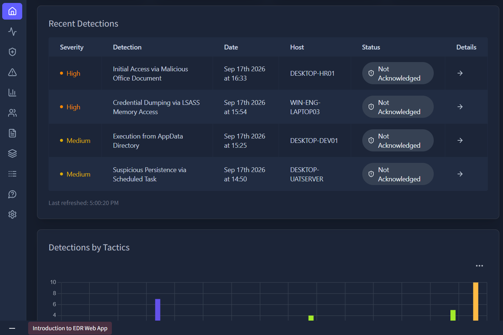
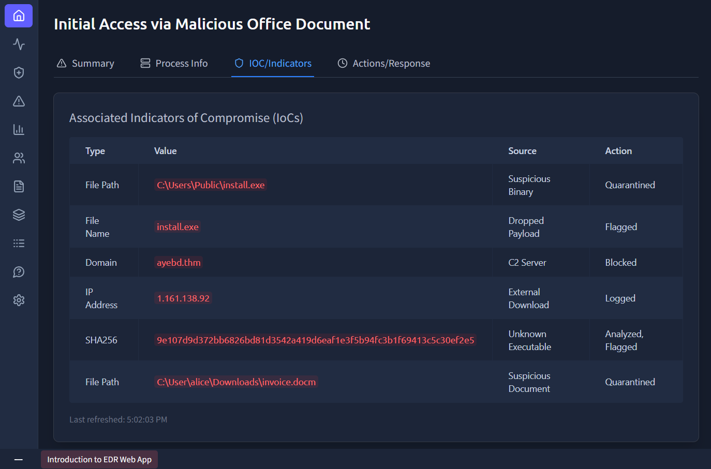

# 🛡️ Module 03 — Core SOC Solutions & Incident Triage

> **TryHackMe — SOC Level 1 Path**  
> SIEM Operations | Log Analysis | Endpoint Detection | Incident Investigation


---

## 📌 Module Overview

This module documents my practical learning and investigations involving core Security Operations Center (SOC) technologies through the **TryHackMe SOC Level 1 Path**.

I worked with SIEM platforms and Endpoint Detection and Response (EDR) investigation scenarios to understand how analysts collect security telemetry, investigate suspicious events, identify potential threats, and support incident response.

The module focused on three main areas:

- **Splunk:** Log ingestion, structured data analysis, and Search Processing Language (SPL).
- **Elastic Stack:** Log searching, event filtering, and authentication investigation.
- **EDR:** Endpoint alert triage, process execution chains, suspicious activity, and Indicators of Compromise (IoCs).

My objective was to develop a structured investigation approach, moving from raw security events toward evidence-based conclusions.

---

# 🔎 1. Splunk — SIEM Operations & Log Investigation

**Tool:** [Splunk](https://www.splunk.com/)

Splunk is a Security Information and Event Management (SIEM) and data analytics platform used to search, investigate, and correlate machine-generated data.

In SOC environments, Splunk can help analysts identify suspicious authentication activity, investigate network events, detect potential compromise, and develop security monitoring use cases.

## 1.1 Understanding Splunk Architecture

I studied three important components of Splunk deployments.

| Component | Function |
|---|---|
| Forwarder | Collects and forwards machine-generated data |
| Indexer | Processes and indexes data for searching |
| Search Head | Provides the interface for searching and analyzing indexed data |

### Log Processing Workflow

```text
Endpoints / Servers / Applications
              |
              v
          Forwarders
              |
              v
           Indexers
              |
              v
          Search Head
              |
              v
       SOC Investigations
```

Understanding this architecture helped me identify how endpoint and application telemetry becomes searchable evidence.

---

## 1.2 Log Ingestion & JSON Field Extraction

During the practical exercise, I worked with newline-delimited JSON (NDJSON) logs in the Splunk index:

`VPN_Logs`

JSON logs store information using key-value pairs, making them suitable for structured security investigations.

Important investigation fields may include:

- Usernames
- Source IP addresses
- Authentication actions
- Timestamps
- Connection details
- Session information

### Using `spath`

The `spath` command extracts fields from structured JSON and XML data.

This is useful when investigating logs containing nested attributes that are not already available as searchable fields.

### Practical SPL Query

```spl
index=VPN_Logs
| spath
| search UserName="Maleena"
| stats count
```

### Query Breakdown

| SPL Command | Purpose |
|---|---|
| `index=VPN_Logs` | Searches events within the specified index |
| `spath` | Extracts structured JSON fields |
| `search UserName="Maleena"` | Filters events for the selected username |
| `stats count` | Counts matching events |

### Investigation Objective

The query was used to identify the number of events associated with a specific user.

This type of filtering is useful during authentication investigations because it can help analysts narrow a large dataset to activity associated with an account of interest.



*Figure 1: Investigating VPN log events using SPL, JSON field extraction, and username filtering.*

### SOC Analyst Perspective

A username-based investigation is often the starting point rather than the final conclusion.

An analyst may continue by:

1. Reviewing the account's activity over time.
2. Identifying associated source IP addresses.
3. Comparing successful and failed authentication attempts.
4. Examining unusual login patterns.
5. Investigating activity outside expected working hours.
6. Correlating the findings with other security logs.

For example, repeated failures followed by a successful authentication could justify additional investigation for password spraying or brute-force activity.

However, such activity should not automatically be classified as an attack without supporting evidence.

### Key Learning

Splunk allows analysts to move from large volumes of logs to targeted investigation results through structured querying, filtering, and aggregation.

---

# 📊 2. Elastic Stack — Security Log Investigation

**Tools:** Elasticsearch | Logstash | Kibana | Beats

The Elastic Stack provides capabilities for collecting, processing, storing, searching, and visualizing machine-generated data.

## 2.1 Understanding Elastic Architecture

I studied the roles of the following components:

| Component | Purpose |
|---|---|
| Beats | Lightweight data collection agents |
| Logstash | Log processing and transformation |
| Elasticsearch | Search and analytics engine |
| Kibana | Visualization, searching, and investigation interface |

### Common Data Pipeline

```text
Endpoints / Applications
           |
           v
         Beats
           |
           v
        Logstash
           |
           v
      Elasticsearch
           |
           v
         Kibana
           |
           v
     SOC Investigation
```

This represents one possible deployment architecture. In practice, Elastic supports additional ingestion methods and does not always require Logstash.

---

## 2.2 Filtering Security Events

During the exercises, I worked with security logs and applied filters to narrow investigation results.

Examples of investigated fields included:

```text
UserName: Emanda
Source_ip
action: failed
```

### Investigation Workflow

1. Opened the relevant log data in Kibana.
2. Applied a time range to narrow the investigation scope.
3. Filtered events associated with a specific username.
4. Examined source IP information.
5. Investigated failed authentication events.
6. Reviewed the relationship between users, authentication results, and connection activity.



*Figure 2: Filtering security events using user attributes and authentication-related fields in Elastic.*

## 2.3 Investigating Failed Authentication Activity

Failed authentication events can result from:

- Incorrect passwords
- Expired credentials
- Misconfigured applications
- Automated login attempts
- Password spraying
- Brute-force attacks

### SOC Investigation Approach

When investigating authentication failures, I learned the importance of checking:

- Number of failed attempts
- Source IP addresses
- Affected accounts
- Event timestamps
- Successful logins following failures
- Whether multiple accounts are targeted from the same source

### Example Investigative Logic

A large number of failed logins from one IP address may warrant investigation.

However, distinguishing malicious activity from legitimate user mistakes requires additional context.

For example:

**Multiple failed logins → same source IP → several affected accounts → potential password-spraying investigation**

This is a general detection hypothesis, not a confirmed attack outcome from the documented lab.

### Key Learning

Elastic enables analysts to filter security telemetry efficiently and investigate activity across users, hosts, IP addresses, and event types.

Time-based filtering is particularly important because incidents must be investigated within the correct chronological context.

---

# 🚨 3. Endpoint Detection & Response (EDR)

EDR technologies provide visibility into endpoint behavior and help security analysts investigate suspicious activity.

Common EDR telemetry includes:

- Process creation
- Parent-child process relationships
- Command-line arguments
- File operations
- Registry modifications
- Network connections
- Security detections

The practical scenarios focused on understanding how these artifacts can be correlated during investigations.

---

## 3.1 Scenario A — Suspicious Office Document Execution

### Initial Observation

The investigation involved a Microsoft Word macro-enabled document:

`invoice.docm`

The suspicious execution chain involved the document leading to `cmd.exe` execution and use of `curl` to retrieve a payload.

### Why This Matters

Office documents are frequently used as initial delivery mechanisms for malicious content.

A document that launches command-line utilities or downloads an executable may indicate malicious behavior.

### Simplified Investigation Chain

```text
Suspicious Word Document
        |
        v
     cmd.exe
        |
        v
   curl command
        |
        v
 Remote Payload Retrieval
```

### Investigation Focus

I examined the significance of:

- Suspicious process relationships
- Unexpected command-line execution
- Network-based payload retrieval
- Possible initial access behavior

### SOC Interpretation

A Word document triggering command execution is unusual enough to justify investigation, particularly when combined with a remote download.

However, the analyst should still establish the full process chain, command-line arguments, file origin, and execution context before reaching a final verdict.

---

## 3.2 Scenario B — Suspicious LSASS Access

### Initial Observation

The investigation involved a suspicious process:

`syncsvc.exe`

The process was associated with access to:

`lsass.exe`

### What is LSASS?

The Local Security Authority Subsystem Service (LSASS) handles important Windows security functions, including authentication-related operations.

Because LSASS memory may contain sensitive authentication material, attackers sometimes attempt to access it for credential theft.

### Investigation Focus

I examined why unexpected LSASS access should be investigated using evidence such as:

- Process identity
- Executable path
- Parent process
- User and privilege context
- Process access activity
- Related alerts

### MITRE ATT&CK Context

Potential credential dumping from LSASS memory is associated with:

**T1003.001 — OS Credential Dumping: LSASS Memory**

This technique mapping describes the suspicious behavior under investigation, not independently confirmed credential extraction.

### SOC Interpretation

Access to LSASS is not automatically malicious because legitimate security and system software may interact with it.

A stronger finding requires contextual evidence, such as unusual access rights, suspicious execution history, memory dump creation, or related malicious behavior.

---

## 3.3 Scenario C — Persistence Through Windows Run Keys

### Initial Observation

The exercise involved suspicious persistence using Windows Run Registry Keys.

Attackers may use these locations to configure programs to execute when a user logs in.

### Example Registry Locations

```text
HKCU\Software\Microsoft\Windows\CurrentVersion\Run

HKLM\Software\Microsoft\Windows\CurrentVersion\Run
```

### Security Concern

An attacker may create a registry entry pointing to a malicious executable to establish persistence.

### MITRE ATT&CK Context

**T1547.001 — Boot or Logon Autostart Execution: Registry Run Keys / Startup Folder**

### Investigation Focus

During this scenario, I studied how analysts evaluate:

- Newly created or modified registry values
- Referenced executable paths
- Suspicious file locations
- Associated process execution
- Related endpoint alerts

### SOC Interpretation

Not every Run Key entry is malicious.

The assessment depends on the associated executable, its origin, behavior, and surrounding endpoint evidence.

---

## 3.4 Scenario D — Suspicious Network Communication

### Initial Observation

The investigation involved outbound communication associated with:

`files-wetransfer.com`

### Investigation Focus

I examined how endpoint telemetry can help analysts investigate:

- Destination domains
- Processes initiating connections
- Suspicious network activity
- Related file downloads
- Potential relationships between process execution and outbound traffic

### SOC Interpretation

A suspicious domain or unexpected outbound connection may indicate malware delivery, command-and-control activity, or another unwanted behavior.

However, domain communication alone does not confirm a specific attack technique.

The analyst should correlate the destination with its initiating process, reputation context, timing, and other host activity.

---

# 🔬 4. EDR Alert Triage & Investigation

The EDR scenarios provided experience with examining alerts and identifying relevant supporting artifacts.

## 4.1 Reviewing Security Detections

An EDR alert may include:

- Detection name
- Severity
- Hostname
- Affected user
- Process name
- File path
- Timestamp
- Detection details

The initial objective is to determine whether the alert represents expected behavior, a false positive, or potentially malicious activity.



*Figure 3: Reviewing EDR security detections and identifying endpoint activity requiring further investigation.*

## 4.2 Indicator Investigation

I examined different types of Indicators of Compromise (IoCs), including:

| Indicator Type | Investigation Value |
|---|---|
| Process name | Identifies involved applications |
| File path | Reveals file location and execution context |
| Domain | Identifies a network destination |
| Registry key | Provides potential persistence evidence |
| Command line | Reveals process arguments and execution behavior |
| File hash | Supports sample identification and reputation checks |



*Figure 4: Reviewing endpoint indicators associated with suspicious processes, registry activity, and network connections.*

### Key Learning

An isolated indicator rarely tells the full story.

A stronger EDR investigation correlates:

**Alert → Process Tree → Command Line → File / Registry Activity → Network Connections → Investigation Verdict**

This approach helps reduce incorrect conclusions based on a single alert or suspicious-looking artifact.

---

# 🧠 5. SOC Incident Triage Methodology

The module helped me understand how analysts investigate security events in a structured manner.

| Stage | Analyst Activity |
|---|---|
| 1. Alert Review | Identify the detection, affected asset, and reported behavior |
| 2. Initial Scoping | Determine the relevant time range and affected entities |
| 3. Evidence Collection | Review logs, process information, and associated indicators |
| 4. Correlation | Connect related activities across available telemetry |
| 5. Threat Assessment | Evaluate whether the evidence supports suspicious or malicious activity |
| 6. Escalation | Recommend appropriate containment or further investigation |
| 7. Documentation | Record findings, limitations, and next steps |

### Important SOC Principles

**Context matters:** A suspicious process name or failed login event does not automatically confirm malicious activity.

**Time matters:** Correct time ranges are necessary to reconstruct an incident.

**Correlation matters:** Combining SIEM and endpoint telemetry can provide stronger evidence than examining individual events in isolation.

**Evidence matters:** Investigation conclusions should clearly distinguish confirmed observations from hypotheses.

---

# 🎯 6. MITRE ATT&CK Context

Some behaviors studied in the EDR scenarios relate to the following MITRE ATT&CK techniques:

| Technique | ID | Relevance |
|---|---|---|
| Phishing: Spearphishing Attachment | T1566.001 | Possible malicious document delivery |
| Command and Scripting Interpreter: Windows Command Shell | T1059.003 | Suspicious `cmd.exe` execution |
| OS Credential Dumping: LSASS Memory | T1003.001 | Suspicious LSASS access scenario |
| Boot or Logon Autostart Execution: Registry Run Keys / Startup Folder | T1547.001 | Registry-based persistence |

These mappings explain relevant attacker techniques and do not imply that every technique was conclusively confirmed in every exercise.

Reference: [MITRE ATT&CK](https://attack.mitre.org/)

---

# 💡 7. Practical Skills Developed

### SIEM & Log Investigation

- Understanding SIEM architecture
- JSON log field extraction
- SPL query development
- Time-based event filtering
- Authentication event investigation
- Log aggregation and searching

### Endpoint Security

- EDR alert triage
- Process tree investigation
- Suspicious command-line analysis
- LSASS access investigation
- Registry persistence analysis
- Suspicious network activity investigation

### Threat Investigation

- IOC identification
- Event correlation
- MITRE ATT&CK technique mapping
- Evidence-based incident assessment
- Investigation documentation
- Recommended response and escalation

---

# 🚀 8. Future Development

The concepts covered in this module provide a foundation for more advanced hands-on SOC investigations.

I plan to expand these skills through separate projects involving:

### Microsoft Sentinel
- KQL-based security investigations
- Alert triage
- Log correlation
- Incident documentation

### Splunk
- More advanced SPL queries
- Investigation dashboards
- Security event correlation
- Detection engineering exercises

These future projects will be documented separately as my practical SIEM experience develops.

---

## 📚 References

- [TryHackMe](https://tryhackme.com/)
- [Splunk Documentation](https://docs.splunk.com/)
- [Elastic Documentation](https://www.elastic.co/docs)
- [MITRE ATT&CK](https://attack.mitre.org/)

---

**Author:** [Shahd Tamee](https://github.com/shahdtamee)  
**Learning Path:** TryHackMe SOC Level 1  
**Focus:** Blue Team | SIEM | EDR | Incident Triage
