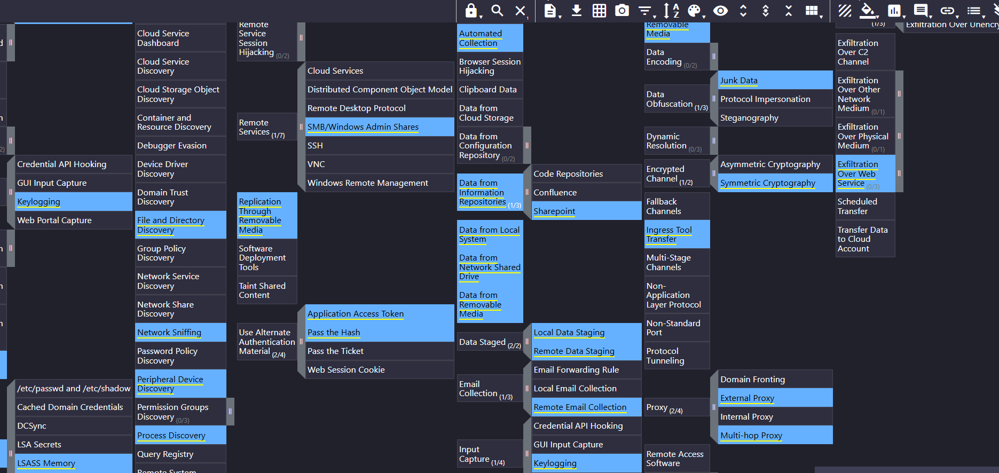
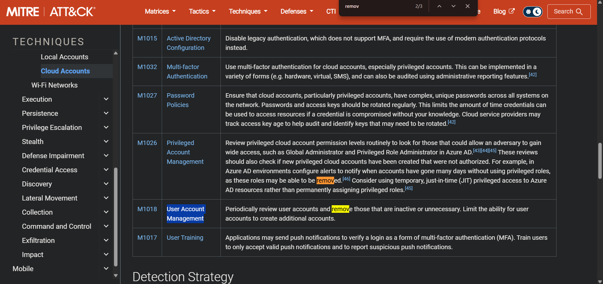
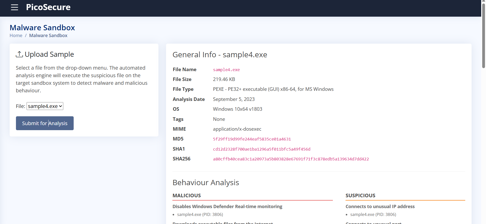
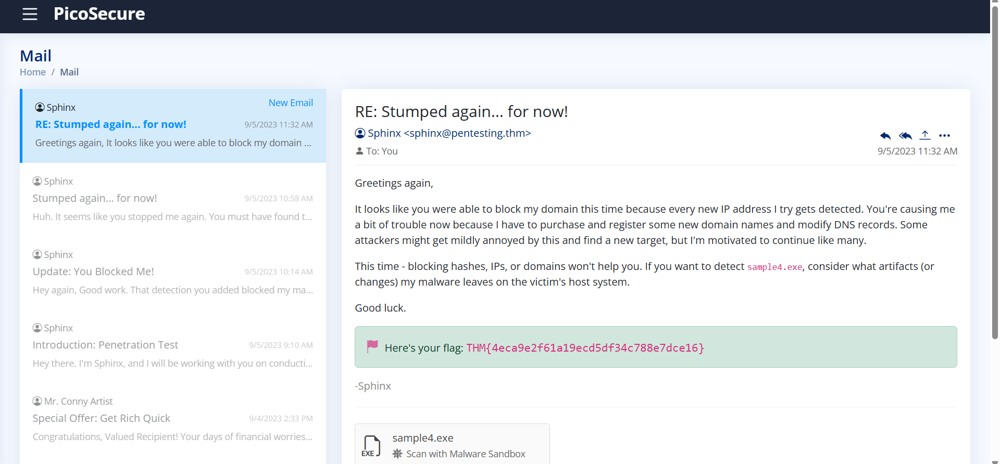

# 🛡️ Module 04 — Cyber Defence Frameworks & Threat Intelligence Mapping

> **TryHackMe — SOC Level 1 Path**  
> Threat Intelligence | MITRE ATT&CK | Malware Analysis | Detection Engineering


---

## 📌 Module Overview

This module documents my learning and hands-on investigations from the **Cyber Defence Frameworks** section of the TryHackMe SOC Level 1 Path.

The main objective was to understand how SOC analysts use threat intelligence and cybersecurity frameworks to interpret attacker behavior, map adversary techniques, identify security coverage gaps, and develop detection strategies.

Throughout this module, I worked with:

- Pyramid of Pain
- Cyber Kill Chain
- Unified Kill Chain (UKC)
- MITRE ATT&CK
- MITRE D3FEND
- MITRE ATT&CK Navigator
- Malware analysis and threat intelligence
- Firewall mitigation techniques
- Sysmon telemetry and Sigma detection logic

The most important lesson was understanding how to turn threat intelligence into **actionable defensive measures**, rather than simply collecting indicators.

---

# 🎯 1. Pyramid of Pain — Threat Intelligence Prioritization

The **Pyramid of Pain**, developed by David J. Bianco, explains how different types of threat indicators affect an adversary when defenders detect or deny their use.

Not all Indicators of Compromise (IOCs) provide equal defensive value.

## Indicator Hierarchy

| Indicator | Description | Adversary Difficulty |
|---|---|---|
| Hash Values | Cryptographic fingerprints of files | Trivial |
| IP Addresses | Network addresses used by adversaries | Easy |
| Domain Names | Domains associated with malicious infrastructure | Simple |
| Network/Host Artifacts | Observable characteristics left by malicious activity | Annoying |
| Tools | Software used to perform malicious actions | Challenging |
| TTPs | Tactics, Techniques, and Procedures | Tough |

### SOC Analyst Perspective

A file hash can help identify a known malicious binary, but an attacker may change the file and generate a different hash.

IP addresses and domains may also be replaced.

Behavioral detections targeting techniques such as credential dumping, unusual process execution, or persistence can be harder for attackers to evade because they target how an attack operates.

### Practical Takeaway

I learned why SOC analysts should combine:

- IOC-based detection for identifying known threats.
- Behavioral detection for identifying suspicious techniques.
- Threat intelligence enrichment for understanding adversary context.

**Key lesson:** Detection engineering should not rely exclusively on indicators that attackers can easily replace.

---

# 🔗 2. Cyber Kill Chain & Unified Kill Chain

## 2.1 Cyber Kill Chain

The Lockheed Martin Cyber Kill Chain describes seven stages commonly associated with intrusion activity.

| Stage | Description |
|---|---|
| Reconnaissance | Gathering information about a target |
| Weaponization | Preparing malicious tools or payloads |
| Delivery | Transmitting malicious content |
| Exploitation | Exploiting a weakness |
| Installation | Establishing malicious software or access |
| Command & Control | Communicating with compromised systems |
| Actions on Objectives | Performing the attacker's intended activity |

### Defensive Relevance

The framework helps analysts identify opportunities to detect or interrupt an intrusion at different stages.

For example:

- Email filtering may disrupt malicious delivery.
- Endpoint protection may detect payload execution.
- Network monitoring may identify suspicious C2 communication.

### Framework Limitation

The traditional Cyber Kill Chain is useful for explaining attack progression but is less detailed when describing complex internal activity, lateral movement, and modern multi-stage intrusions.

---

## 2.2 Unified Kill Chain — 18 Phases

The **Unified Kill Chain (UKC)** expands the traditional lifecycle by providing a more detailed representation of adversary activity.

Its 18 phases are grouped into three major categories.

### IN — Initial Foothold

1. Reconnaissance
2. Weaponization
3. Delivery
4. Social Engineering
5. Exploitation
6. Persistence
7. Defense Evasion
8. Command & Control
9. Pivoting

### THROUGH — Network Propagation

10. Discovery
11. Privilege Escalation
12. Execution
13. Credential Access
14. Lateral Movement

### OUT — Action on Objectives

15. Collection
16. Exfiltration
17. Impact
18. Objectives

### Practical Understanding

The Unified Kill Chain helped me understand how an intrusion may progress from initial compromise to internal propagation and eventual attacker objectives.

For example:

```text
Reconnaissance
      |
      v
Malicious Email Delivery
      |
      v
User Interaction / Exploitation
      |
      v
Persistence & Defense Evasion
      |
      v
Command & Control
      |
      v
Internal Discovery
      |
      v
Credential Access
      |
      v
Lateral Movement
      |
      v
Data Collection / Exfiltration
```

This is an illustrative sequence, not a confirmed chain observed in a single lab.

**SOC takeaway:** An attack does not necessarily follow every phase in a fixed sequence. Frameworks are analytical models used to understand and investigate behavior.

---

# 🎯 3. MITRE ATT&CK — Threat Actor Profiling

**Framework:** [MITRE ATT&CK](https://attack.mitre.org/)

MITRE ATT&CK is a knowledge base of adversary tactics and techniques based on observed threat behavior.

It provides a common language for describing what attackers attempt to achieve and how they operate.

## 3.1 Understanding Tactics and Techniques

A **tactic** describes the attacker's objective.

A **technique** describes how the adversary may achieve that objective.

A **sub-technique** provides a more specific implementation of a technique.

### Example

```text
Tactic: Reconnaissance
ID: TA0043

Technique: Phishing for Information
ID: T1598

Sub-technique: Spearphishing Link
ID: T1598.003
```

### ATT&CK Tactics Studied

| Tactic | ID | Purpose |
|---|---|---|
| Reconnaissance | TA0043 | Gather information about targets |
| Execution | TA0002 | Run malicious code |
| Persistence | TA0003 | Maintain access |
| Defense Evasion | TA0005 | Avoid security defenses |
| Command and Control | TA0011 | Communicate with compromised systems |
| Exfiltration | TA0010 | Steal data from an environment |

---

## 3.2 Threat Actor Profiling

I explored threat actor information in the ATT&CK knowledge base, including:

- APT33
- APT28
- Mustang Panda (G0129)

Threat actor profiles can contain information about:

- Known techniques
- Associated malware
- Tools and infrastructure
- Historical campaigns
- Targeting patterns
- Documented procedures

### Why Threat Actor Profiling Matters

Threat actor information helps defenders understand which techniques are associated with reported adversary activity.

However, identifying a technique does not automatically identify the attacker.

Multiple threat groups may use the same tools or techniques, so attribution requires additional evidence.

---

## 3.3 MITRE ATT&CK Navigator

**Tool:** [ATT&CK Navigator](https://mitre-attack.github.io/attack-navigator/)

ATT&CK Navigator provides an interactive way to visualize tactics and techniques.

I explored its application to threat actor profiling and technique coverage, including APT28-associated TTPs.



*Figure 1: Visualizing APT28-associated tactics, techniques, and sub-techniques through MITRE ATT&CK Navigator.*

### Analyst Applications

ATT&CK Navigator can support:

1. Mapping known adversary techniques.
2. Identifying technique coverage.
3. Comparing threat profiles.
4. Prioritizing security monitoring.
5. Visualizing potential detection gaps.

### SOC Takeaway

Threat actor intelligence becomes more useful when translated into questions such as:

- Which techniques are relevant to our environment?
- Do we collect the telemetry needed to detect them?
- Which techniques are currently monitored?
- Where do detection gaps remain?

A colored ATT&CK Navigator layer does not automatically prove that a security control is effective. Coverage should be supported by tested detections.

---

# 🛡️ 4. MITRE D3FEND & Defensive Countermeasures

**Framework:** [MITRE D3FEND](https://d3fend.mitre.org/)

MITRE D3FEND describes defensive cybersecurity techniques and their relationships to digital artifacts and offensive activity.

Where ATT&CK describes adversary behavior, D3FEND provides a structured vocabulary for defensive techniques.

## 4.1 User Geolocation Logon Pattern Analysis

**D3FEND ID:** `D3-UGLPA`

This defensive technique focuses on examining patterns in login locations to identify potentially abnormal authentication behavior.

### Example Security Scenario

A user normally signs in from one geographic region.

An authentication event suddenly originates from an unexpected location.

Potential investigation questions include:

- Is the location unusual for this account?
- Was a VPN or proxy used?
- Is the originating IP associated with known suspicious activity?
- Were multiple authentication failures recorded?
- Did the login result in suspicious follow-up activity?

### Important Limitation

IP geolocation can be inaccurate, and unusual geography alone does not confirm account compromise.

---

## 4.2 Valid Cloud Accounts & User Account Management

I explored the relationship between:

**MITRE ATT&CK:**

`T1078.004 — Valid Accounts: Cloud Accounts`

**ATT&CK Mitigation:**

`M1018 — User Account Management`

### Threat Description

Attackers may abuse legitimate cloud accounts to access services or resources.

Because authentication is performed using valid credentials, the activity may resemble normal account usage.

### Defensive Measures

Relevant controls can include:

- Regular account reviews
- Removal of unused accounts
- Restricting excessive privileges
- Monitoring suspicious authentication behavior
- Reviewing service and administrative accounts
- Enforcing appropriate account lifecycle policies



*Figure 2: Exploring MITRE ATT&CK mitigations for valid cloud account abuse.*

### Key Learning

Threat intelligence mapping helps defenders identify meaningful preventive and detective controls.

The purpose is not simply to block a known indicator, but to reduce opportunities for an attacker to perform the underlying technique.

---

# 🔬 5. Practical Lab — Malware Analysis & Firewall Mitigation

This section documents malware-analysis activities and defensive countermeasures explored in a TryHackMe lab.

## 5.1 Static Malware Analysis

Static analysis examines a file without executing it.

I practiced identifying useful file properties and indicators, including:

- MD5 hashes
- SHA-256 hashes
- File characteristics
- Known threat indicators

### Hash Investigation

Example Linux commands:

```bash
md5sum suspicious_sample
sha256sum suspicious_sample
```

These illustrate how to calculate file fingerprints.

### Why Hashes Matter

Hashes help analysts:

- Identify previously reported samples.
- Search existing threat intelligence.
- Compare evidence across systems.
- Record investigated artifacts.
- Support security monitoring and incident response.

**Limitation:** A malicious file can be modified to generate a new hash, so hashes should not be the only detection mechanism.

---

## 5.2 Dynamic Malware Analysis

Dynamic analysis examines the behavior of a sample in a controlled environment.

During the exercise, I investigated behavioral evidence such as:

- Suspicious process execution
- Network communications
- Potential command-and-control activity
- Attempts to interfere with security tooling



*Figure 3: Examining a suspicious sample and its behavior in a sandbox analysis environment.*

### Investigation Approach

1. Identify the suspicious file.
2. Record the file's hash.
3. Examine available analysis results.
4. Review process activity.
5. Investigate network communication.
6. Extract relevant indicators.
7. Consider appropriate defensive controls.

### Key Learning

A file's behavior can provide more useful investigative evidence than its filename or hash alone.

Behavioral analysis helps analysts understand what a suspicious program attempts to do after execution.

---

## 5.3 Egress Firewall Controls

The lab included defensive measures aimed at interrupting suspicious outbound communication.

### What is Egress Filtering?

Egress filtering controls network traffic leaving a system or network.

It can be used to restrict unauthorized communication with external infrastructure.

### Investigated Scenario

The exercise involved identifying suspicious outbound communication over:

`443/TCP`

A deny rule was used in the training scenario to block the relevant communication path.

### Defensive Concept

```text
Potentially Compromised Host
             |
             v
       Firewall Policy
             |
      Outbound Deny Rule
             |
             X
  Identified C2 Destination
```

### Why This Matters

Blocking confirmed malicious destinations can disrupt communication between compromised systems and attacker-controlled infrastructure.

However, blocking all outbound traffic on port 443 would usually disrupt legitimate HTTPS services.

A production firewall policy should therefore be scoped to the relevant destination, asset, and risk.



*Figure 4: Documenting the result of the TryHackMe defensive lab exercise.*

### SOC Takeaway

Malware analysis can produce indicators that help security teams develop targeted containment and blocking actions.

The effectiveness of a mitigation should be validated, rather than assumed from rule creation alone.

---

# ⚙️ 6. Sysmon & Sigma — Detection Engineering

One of the most important topics in this module was learning how defensive detection logic can be developed using endpoint telemetry.

## 6.1 What is Sysmon?

**System Monitor (Sysmon)** is a Windows system service and driver that can record detailed endpoint events.

Depending on configuration, Sysmon can log information including:

- Process creation
- Network connections
- File creation
- Registry modifications
- Process access
- Image loading

These events can support investigations into malicious activity.

## 6.2 What is Sigma?

**Sigma** is an open, YAML-based format for describing log detection rules.

Sigma allows analysts to express detection logic in a portable way that can be translated for different supported SIEM backends.

A detection rule generally defines:

- Relevant log source
- Event fields
- Selection conditions
- Detection logic
- Supporting metadata
- Optional ATT&CK mappings

**Important:** Sigma rules are detection specifications. They are not automatically active in a SIEM until translated, deployed, and appropriately tested.

---

## 6.3 Detection Scenario A — Windows Defender Tampering

### Detection Objective

Identify suspicious attempts to disable Windows Defender real-time protection through registry modifications.

### Relevant Tactic

`TA0005 — Defense Evasion`

### Investigated Indicator

```text
DisableRealtimeMonitoring = 1
```

### Detection Approach

Monitor relevant registry activity and determine whether a process modifies a security-sensitive value.

Sysmon registry events can provide evidence of modifications when the required event types and paths are configured for collection.

### Example Sigma Detection Logic

The following is an illustrative rule fragment, not a verified export from the completed TryHackMe exercise:

```yaml
title: Potential Defender Realtime Monitoring Disable
logsource:
    product: windows
    category: registry_set
detection:
    selection:
        TargetObject|endswith: '\Real-Time Protection\DisableRealtimeMonitoring'
        Details: 'DWORD (0x00000001)'
    condition: selection
```

### Analyst Considerations

A relevant registry value does not guarantee that real-time protection was successfully disabled.

The analyst should also examine:

- The process responsible for the change
- The initiating user
- Device protection status
- Associated alerts
- Related process activity

### Key Learning

Detection logic should identify relevant behavior while preserving enough context to distinguish administrative actions from potentially malicious activity.

---

## 6.4 Detection Scenario B — Command & Control Beaconing

### Detection Objective

Identify potentially automated outbound network communications exhibiting periodic behavior.

### Relevant Tactic

`TA0011 — Command and Control`

### Lab Characteristics

| Characteristic | Value |
|---|---|
| Connection interval | 1800 seconds |
| Equivalent interval | 30 minutes |
| Packet size | 97 bytes |
| Destination IP | Any |

### Technical Explanation

Some malware communicates with attacker-controlled infrastructure at repeated intervals.

This behavior is commonly described as beaconing.

A potentially suspicious pattern might involve:

```text
00:00  Connection
00:30  Connection
01:00  Connection
01:30  Connection
02:00  Connection
```

The example demonstrates periodic activity.

### Detection Considerations

A robust beaconing detection should examine multiple events and consider:

- Connection frequency
- Timing consistency
- Process identity
- Source and destination relationships
- Network activity baselines
- Legitimate scheduled applications

Monitoring any destination IP avoids relying on one fixed address, but it also increases the need for contextual filtering.

### Key Learning

A repeated interval can be a useful indicator, but periodic traffic alone does not confirm malware.

In production, beaconing detection usually requires correlation over time rather than a simple one-event Sigma match.

---

## 6.5 Detection Scenario C — Data Staging

### Detection Objective

Identify the creation of a suspicious file potentially used to collect system information before exfiltration.

### Relevant ATT&CK Context

`TA0010 — Exfiltration`

However, the observed file-creation behavior itself represents potential local staging, not proof that exfiltration occurred.

### Relevant Sysmon Event

`Event ID 11 — FileCreate`

### Investigated Artifact

```text
%temp%\exfiltr8.log
```

### Technical Explanation

Attackers may collect command output or other information into temporary files before transferring it.

For example, a script might redirect system discovery command output into a local file.

### Illustrative Detection Logic

```yaml
title: Suspicious Temporary Data Staging File
logsource:
    product: windows
    category: file_event
detection:
    selection:
        TargetFilename|endswith: '\exfiltr8.log'
    condition: selection
```

This is an example of filename-based detection logic.

It is useful for describing the training scenario but is not a generalized exfiltration detection.

### Investigation Requirements

To determine whether an exfiltration attempt occurred, an analyst would need additional evidence such as:

- Commands that created or populated the file
- Processes interacting with the file
- Network connections from those processes
- File-transfer activity
- Relevant destination infrastructure

### SOC Takeaway

Detecting a suspicious file can provide an investigation starting point.

A defensible incident classification requires correlating file events with process and network telemetry.

---

# 🧠 7. Threat Intelligence to Detection Workflow

This module helped me understand how analysts can translate threat intelligence into defensive monitoring.

| Phase | Analyst Activity |
|---|---|
| 1. Intelligence Collection | Gather threat reports, techniques, and indicators |
| 2. Threat Mapping | Map behavior to MITRE ATT&CK |
| 3. Telemetry Identification | Determine which logs can reveal the behavior |
| 4. Detection Development | Create detection logic using relevant event fields |
| 5. Testing | Evaluate expected detections and false positives |
| 6. Triage | Investigate relevant alerts and supporting evidence |
| 7. Improvement | Refine detection logic using investigation results |

### Example

**Threat intelligence:** An attacker attempts to disable endpoint protection.

**ATT&CK mapping:** Defense Evasion.

**Telemetry requirement:** Registry modification events.

**Detection logic:** Identify relevant changes to Defender-related registry values.

**Investigation:** Determine which process made the modification and whether protection was affected.

**Response:** Escalate confirmed suspicious behavior and recommend appropriate containment.

This workflow connects attacker behavior with observable telemetry and practical defensive actions.

---

# 🎯 8. Skills Developed

### Threat Intelligence

- IOC prioritization using the Pyramid of Pain
- Threat actor profiling
- MITRE ATT&CK navigation
- Tactic and technique mapping
- Adversary behavior analysis

### Defensive Frameworks

- Cyber Kill Chain
- Unified Kill Chain
- MITRE ATT&CK
- MITRE D3FEND
- ATT&CK mitigations

### Malware & Network Defense

- File hash investigation
- Static and dynamic malware analysis
- Process behavior review
- Network IOC identification
- Egress filtering concepts

### Detection Engineering

- Sysmon event interpretation
- Sigma rule structure
- Registry tampering detection
- Beaconing detection concepts
- Data staging detection
- Correlation of endpoint and network evidence

---

# 💡 9. Key Lessons Learned

**1. Not all threat intelligence has equal defensive value.**

Behavioral information can support more resilient detections than relying only on hashes and IP addresses.

**2. Frameworks are tools for analysis, not rigid attack sequences.**

Attackers may skip, repeat, or combine techniques depending on their objectives.

**3. MITRE ATT&CK provides a common investigation language.**

Mapping observed behavior to techniques helps analysts communicate findings and evaluate detection coverage.

**4. Threat intelligence should support actionable defense.**

Understanding an adversary's behavior is most valuable when it helps develop monitoring, prevention, or response measures.

**5. Detection rules need testing and context.**

A match against suspicious behavior is an investigation signal, not necessarily confirmation of compromise.

**6. Different data sources support different conclusions.**

Registry telemetry can identify persistence-related modifications, while network telemetry can help investigate communication and possible exfiltration.

---

# 🚀 10. Future Development

The skills developed in this module provide a foundation for more advanced Blue Team projects.

My future hands-on work will focus on:

### Microsoft Sentinel
- KQL-based investigations
- Security alert triage
- MITRE ATT&CK mapping
- Detection analysis
- Incident reporting

### Splunk
- SPL-based security investigations
- Log correlation
- Detection engineering
- Behavioral threat hunting

These projects will be documented separately as I develop additional practical experience.

---

## 📚 References

- [TryHackMe](https://tryhackme.com/)
- [Pyramid of Pain — David J. Bianco](https://detect-respond.blogspot.com/2013/03/the-pyramid-of-pain.html)
- [MITRE ATT&CK](https://attack.mitre.org/)
- [MITRE D3FEND](https://d3fend.mitre.org/)
- [MITRE ATT&CK Navigator](https://mitre-attack.github.io/attack-navigator/)
- [Sigma Detection Rules](https://github.com/SigmaHQ/sigma)
- [Microsoft Sysmon Documentation](https://learn.microsoft.com/en-us/sysinternals/downloads/sysmon)

---

**Author:** [Shahd Tamee](https://github.com/shahdtamee)  
**Learning Path:** TryHackMe SOC Level 1  
**Focus:** Threat Intelligence | Detection Engineering | Blue Team
