# 🎣 Module 05 — Phishing Analysis & Email Threat Investigation

> **TryHackMe — SOC Level 1 Path**  
> Email Security | Threat Intelligence | Malware Analysis | Network Investigation


---

## 📌 Module Overview

This module documents my hands-on experience investigating phishing emails and malicious artifacts through the **TryHackMe SOC Level 1 Path**.

Through guided labs and practical challenges, I worked on:

- Analyzing raw email headers and MIME structures.
- Identifying phishing indicators and suspicious sender domains.
- Investigating file hashes, attachments, and malware reputation.
- Enriching IP addresses using threat intelligence.
- Reviewing dynamic malware sandbox reports.
- Analyzing SMTP traffic using Wireshark.
- Investigating phishing infrastructure and suspicious archives.

My main objective was to develop a structured phishing investigation workflow based on **technical evidence and threat intelligence correlation**, rather than relying on a single detection tool.

### 📚 Completed Rooms

| TryHackMe Room | Main Focus | Status |
|---|---|---|
| Phishing Analysis Fundamentals | Email headers, MIME, attachments | ✅ Completed |
| Phishing Emails in Action | Phishing indicators and sender impersonation | ✅ Completed |
| Phishing Analysis Tools | Threat intelligence and malware analysis | ✅ Completed |
| Phishing Prevention | Email authentication and SMTP traffic | ✅ Completed |
| The Greenholt Phish | Malicious attachment investigation | ✅ Completed |
| Snapped Phish-ing Line | Phishing infrastructure and kit analysis | ✅ Completed |

### 🛠️ Tools & Technologies

| Tool | Investigation Purpose |
|---|---|
| Mozilla Thunderbird | Email source and header investigation |
| VirusTotal | File reputation and malware detection |
| IPinfo | IP ownership and infrastructure enrichment |
| ANY.RUN | Dynamic malware analysis |
| Wireshark | Network traffic and SMTP investigation |
| PhishTool | Phishing email analysis |
| CyberChef | Data decoding and transformation |
| urlscan.io | URL and website investigation |
| Cisco Talos | Threat intelligence and reputation |
| Linux / sha256sum | File hashing |

Some tools were used directly in the documented exercises, while others were studied as part of phishing investigation workflows.

---

# 📧 1. Email Fundamentals & Header Analysis

## 1.1 Email Protocols

Understanding email protocols is essential for analyzing suspicious emails and identifying how they travel through mail infrastructure.

| Protocol | Function |
|---|---|
| SMTP | Sends and relays email messages |
| IMAP | Synchronizes messages across devices |
| POP3 | Retrieves messages from a mail server |

SMTP commonly uses ports 25, 587, and 465, depending on the purpose and transport security configuration.

## 1.2 Email Header Investigation

Email headers provide information about a message's origin, delivery path, and authentication results.

Important fields include:

| Header | SOC Investigation Purpose |
|---|---|
| From | Visible sender identity |
| Return-Path | Envelope sender information |
| Reply-To | Destination for replies |
| Received | Mail delivery hops |
| Authentication-Results | Email authentication findings |
| Message-ID | Message identifier |
| Subject | Email subject |

### 🔬 Practical Investigation — Suspicious Sender Domain

Using Mozilla Thunderbird, I examined the raw source of a suspicious email.

The investigation revealed:

```text
Return-Path: <postmaster@etekno.xyz>
X-Originating-IP: [209.85.167.226]
Received-SPF: none
```

The domain identified for further investigation was:

`etekno[.]xyz`

**Analysis:**

The email used a trusted-service impersonation theme, while the underlying source revealed a different domain.

The SPF result was `none`, meaning an applicable SPF authorization result was not available. This does not independently establish that the message is malicious.

The suspicious domain, sender identity, and message content should be correlated before reaching a verdict.

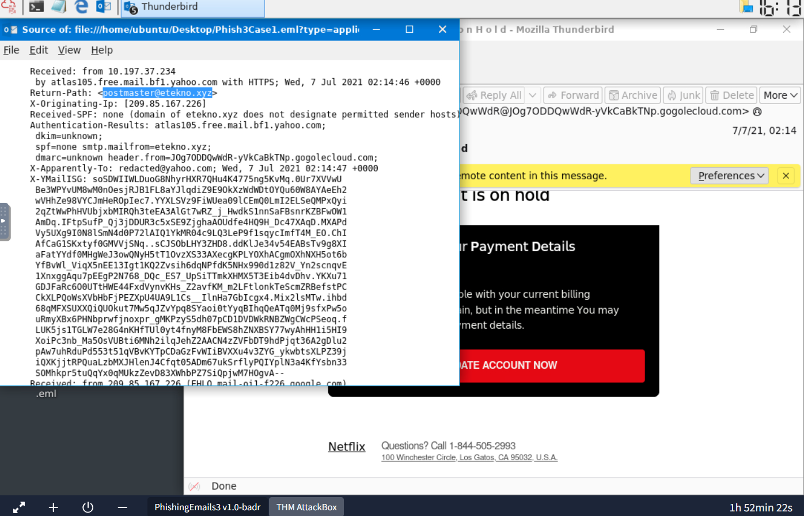

*Figure 1: Inspecting the Return-Path, originating IP, and SPF information using Thunderbird.*

---

## 1.3 MIME & Base64 Attachment Analysis

MIME (Multipurpose Internet Mail Extensions) allows emails to contain HTML content, images, documents, and other attachments.

Important fields include:

- `Content-Type`
- `Content-Disposition`
- `Content-Transfer-Encoding`
- MIME boundaries

### 🔬 Practical Investigation

I inspected an email source file named `email2.txt` in the TryHackMe environment.

The message contained:

```text
Content-Type: application/pdf; name="zmqpalgh.pdf"
Content-Transfer-Encoding: base64
Content-Disposition: attachment; filename="zmqpalgh.pdf"
```

### Findings

- Attachment filename: `zmqpalgh.pdf`
- Declared content type: `application/pdf`
- Transfer encoding: `base64`
- Attachment location: MIME message body

**Technical explanation:**

Base64 converts binary data into a textual representation suitable for transmission.

It is not encryption and does not provide confidentiality.

A SOC analyst can reconstruct the encoded attachment for investigation, preferably inside an isolated analysis environment.

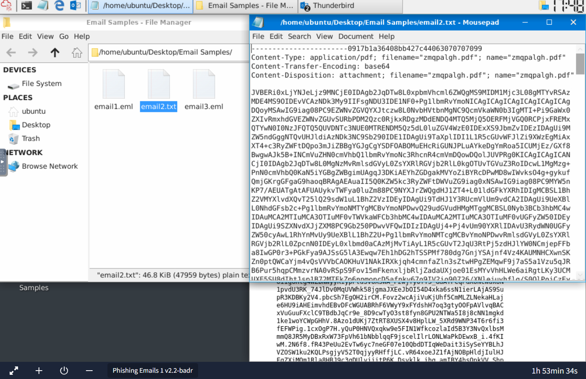

*Figure 2: Identifying a Base64-encoded PDF attachment by inspecting MIME fields in the email source.*

---

# 🛡️ 2. Email Authentication & Phishing Prevention

## 2.1 SPF — Sender Policy Framework

SPF allows domain owners to specify authorized email-sending infrastructure through DNS records.

Example:

```text
v=spf1 ip4:192.0.2.10 -all
```

The `-all` mechanism indicates that unauthorized senders should fail SPF verification.

**Limitation:** SPF does not directly authenticate the visible From address.

## 2.2 DKIM — DomainKeys Identified Mail

DKIM uses digital signatures to verify selected email headers and message content.

The receiving mail system retrieves a public key from DNS to verify the signature.

A valid DKIM result helps demonstrate message integrity since signing, but does not guarantee that the message is safe.

## 2.3 DMARC — Domain-Based Message Authentication, Reporting and Conformance

DMARC builds upon SPF and DKIM by checking alignment with the visible From domain.

| DMARC Policy | Meaning |
|---|---|
| `p=none` | Monitor authentication results |
| `p=quarantine` | Request suspicious handling |
| `p=reject` | Request rejection of failing messages |

### SOC Takeaway

Email authentication is a defensive layer, not a complete phishing prevention solution.

Additional protections include:

- Secure Email Gateways (SEG)
- URL filtering
- Attachment sandboxing
- Malware scanning
- Multi-Factor Authentication (MFA)
- Security awareness training
- SOC monitoring and incident response

---

# 🔎 3. Threat Intelligence & Malware Analysis

## 3.1 VirusTotal — File Reputation Investigation

**Tool:** [VirusTotal](https://www.virustotal.com/)

VirusTotal aggregates detection and reputation information from multiple security engines and analysis services.

It can assist with investigating files, hashes, URLs, IP addresses, and domains.

### 🔬 Investigation A — Password-Protected PDF

I examined a PDF using VirusTotal.

| Property | Result |
|---|---|
| File format | PDF |
| File size | 3.30 MB |
| Detection ratio | 0/66 |
| File characteristic | Password-protected |

The platform displayed a warning that security vendors might not be able to fully inspect the file because it was password-protected.

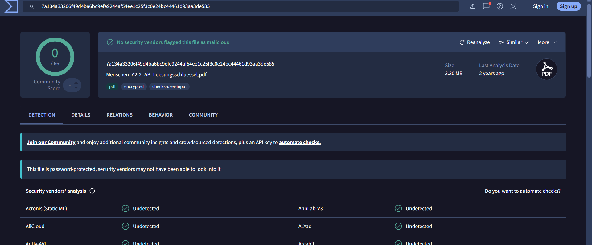

*Figure 3: VirusTotal showing zero detections for a password-protected PDF and warning about possible inspection limitations.*

### Analyst Interpretation

**Zero antivirus detections do not guarantee file safety.**

Encrypted or password-protected content may prevent security tools from inspecting embedded data.

Before classifying a file as benign, an analyst should consider its origin, attachment context, available metadata, and additional analysis results.

---

## 3.2 IPinfo — Infrastructure Enrichment

**Tool:** [IPinfo](https://ipinfo.io/)

IP enrichment provides context about network ownership and infrastructure.

### 🔬 Practical Investigation

I investigated:

`35.89.44.33`

The displayed results included:

| Property | Result |
|---|---|
| Location | Boardman, Oregon, US |
| ASN | AS16509 — Amazon |
| Hostname | omta34.uswest2.a.cloudfilter.net |
| Company | Proofpoint, Inc. |
| Network range | 35.80.0.0/12 |

IPinfo also displayed an abuse-related warning referencing AbuseIPDB.

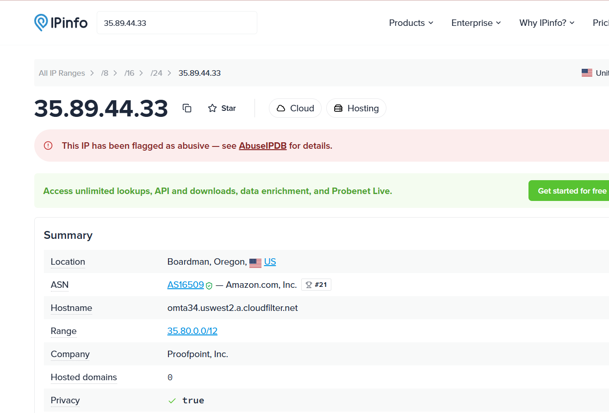

*Figure 4: Investigating IP infrastructure, ASN, hostname, provider information, and abuse context.*

### Analyst Interpretation

IP ownership alone cannot establish maliciousness.

In this example, the hostname and company association provided context consistent with email-security-related infrastructure.

Reputation warnings should be correlated with the system's actual role before interpreting an IP address as malicious.

---

## 3.3 ANY.RUN — Dynamic Malware Analysis

**Tool:** [ANY.RUN](https://any.run/)

ANY.RUN provides interactive malware analysis in an isolated environment.

Dynamic analysis can reveal behavior that may not be apparent through file metadata or static inspection.

### Investigation A — Suspicious PDF

I reviewed a sandbox analysis involving a suspicious PDF identified in the lab as:

`Payment-updateid.pdf`

The interface provided visibility into:

- Process execution
- HTTP requests
- Network communications
- Suspicious activity classifications
- Application behavior

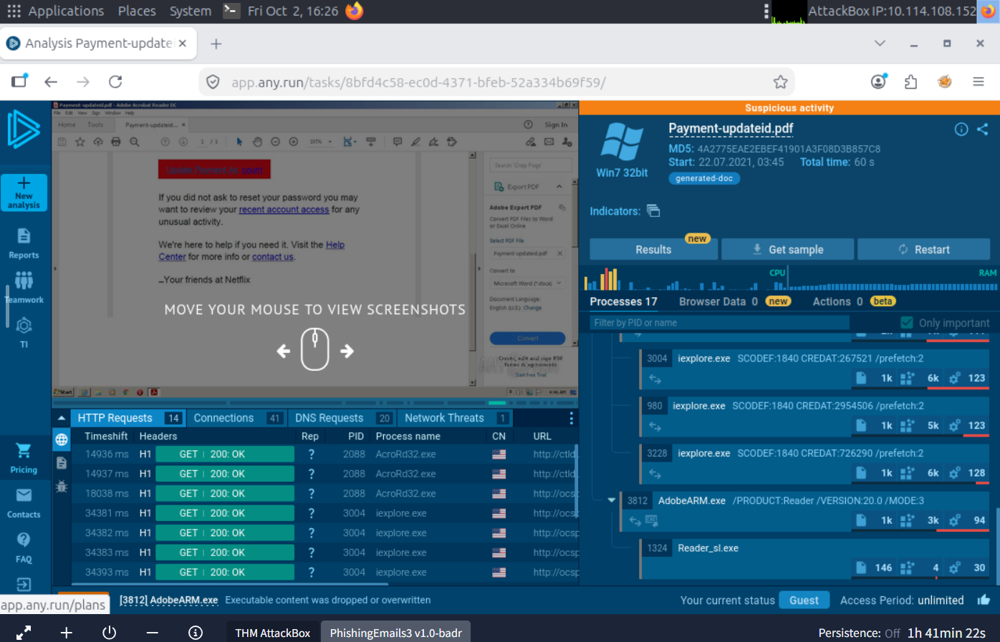

*Figure 5: Reviewing suspicious PDF activity, process information, and network requests in ANY.RUN.*

### Investigation Workflow

1. Identify the suspicious attachment.
2. Obtain its file hash.
3. Review the relevant sandbox report.
4. Examine the process tree.
5. Inspect network and DNS activity.
6. Identify suspicious behavior.
7. Extract relevant indicators.
8. Correlate findings with other investigation evidence.

### Investigation B — Malicious Office Document

In another exercise, I examined a sandbox report associated with a malicious Microsoft Excel document.

The report displayed:

| Indicator | Result |
|---|---|
| Document format | Microsoft Excel 2007+ |
| Classification | Trojan |
| Vulnerability tag | CVE-2017-11882 |
| Malicious IP identified in lab | 204.11.56.48 |
| Malicious domain identified in lab | findresults.site |

### Technical Context — CVE-2017-11882

CVE-2017-11882 is a remote code execution vulnerability involving Microsoft's Equation Editor component.

Crafted Office content may exploit a vulnerable installation.

The presence of the CVE tag in the sandbox report provides useful investigative context, although exploit execution should be confirmed using additional behavioral evidence.

### Indicators of Compromise

```text
IP: 204.11.56.48
Domain: findresults[.]site
CVE: CVE-2017-11882
```

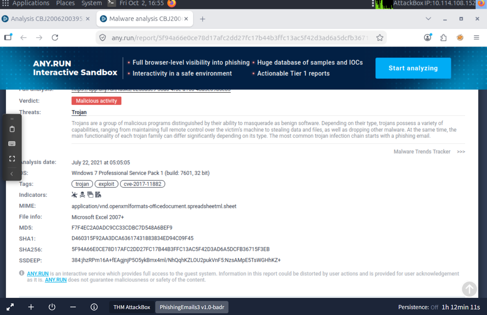

*Figure 6: Reviewing sandbox malware classification, exploit-related tagging, and threat indicators.*

### Key Learning

Dynamic analysis helps connect file execution, suspicious processes, network behavior, and potential exploitation.

These findings can assist SOC analysts with detection, triage, and escalation.

---

# 🌐 4. Wireshark — SMTP Traffic Investigation

**Tool:** [Wireshark](https://www.wireshark.org/)

I investigated email-related network traffic using a provided packet capture:

`traffic.pcap`

The objective was to understand how SMTP communication appears in packet captures and how analysts can investigate delivery events.

## 4.1 SMTP Response Analysis

SMTP servers return status codes that indicate how a request was processed.

| Response Code | Meaning |
|---|---|
| 220 | Service ready |
| 250 | Requested action completed |
| 354 | Start mail input |
| 421 | Service unavailable |
| 450 | Temporary mailbox unavailability |
| 550 | Request rejected or mailbox unavailable |

### Investigation Steps

1. Opened `traffic.pcap` in Wireshark.
2. Examined available network protocols.
3. Investigated SMTP traffic.
4. Reviewed server response codes.
5. Identified relevant conversations for deeper analysis.

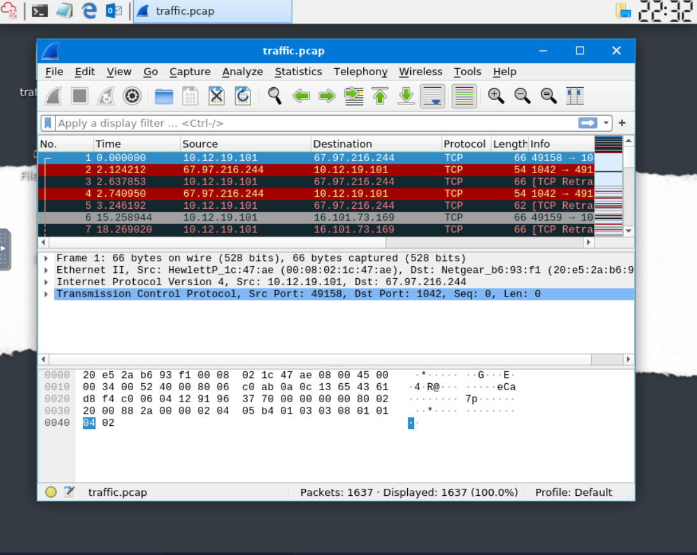

*Figure 7: Investigating the supplied network capture and SMTP response-code analysis.*

---

## 4.2 Follow TCP Stream

Wireshark's **Follow TCP Stream** feature reconstructs application data exchanged within a TCP connection.

During the exercise, I examined an SMTP conversation containing:

```text
EHLO mozilla.org
MAIL FROM:<postmaster@mozilla.org>
RCPT TO:<talkback@mozilla.org>
DATA
Subject: delivery failed
```

The conversation also showed SMTP server response codes and message headers.

The lab included a confirmed count of **512 SMTP packets**.

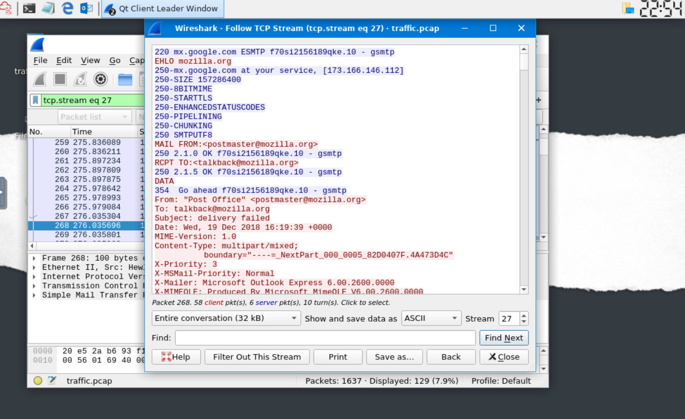

*Figure 8: Reconstructing an SMTP conversation and inspecting commands, delivery responses, and email content.*

### SOC Relevance

SMTP traffic analysis helps investigators understand:

- Which systems exchanged email-related traffic
- Whether messages were accepted or rejected
- Sender and recipient identities presented during the transaction
- Email content and headers when visible
- Suspicious or unexpected delivery behavior

**Limitation:** Encrypted SMTP traffic may prevent an analyst from reading message contents directly from a packet capture.

---

# 🚨 5. Practical Challenge — The Greenholt Phish

**TryHackMe Room:** The Greenholt Phish  
**Investigation Focus:** Suspicious email attachment

## Scenario

The challenge involved investigating a suspicious financial-themed email containing an attachment.

My objective was to examine the message source, identify the attachment, and evaluate available malware reputation evidence.

## 5.1 Email Source Investigation

Using Mozilla Thunderbird, I reviewed the original message source.

The message contained an attachment with a `.CAB` extension and a filename beginning with:

`SWT_#09674321`

The relevant MIME fields included:

```text
Content-Type: application/octet-stream
Content-Transfer-Encoding: base64
```

The financial-themed email and unexpected archive attachment warranted further investigation.

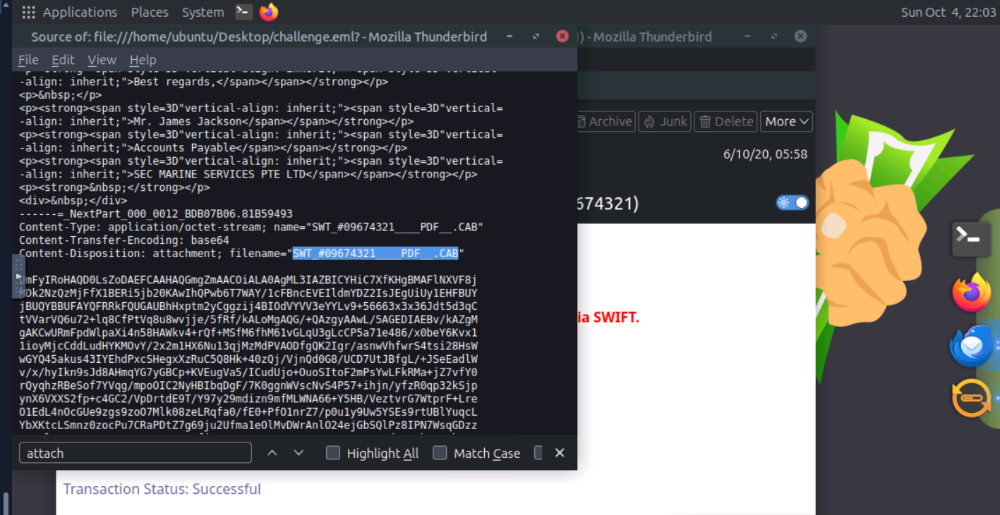

*Figure 9: Inspecting the Greenholt email source and identifying the suspicious attachment.*

---

## 5.2 File Reputation Analysis

I reviewed the attachment's available VirusTotal results.

| Property | Finding |
|---|---|
| File size | Approximately 400.26 KB |
| Detection ratio | 49/64 |
| Popular threat label | trojan.msil/loki |
| Additional family labels | msil, loki, agensla |
| Displayed archive classification | RAR |

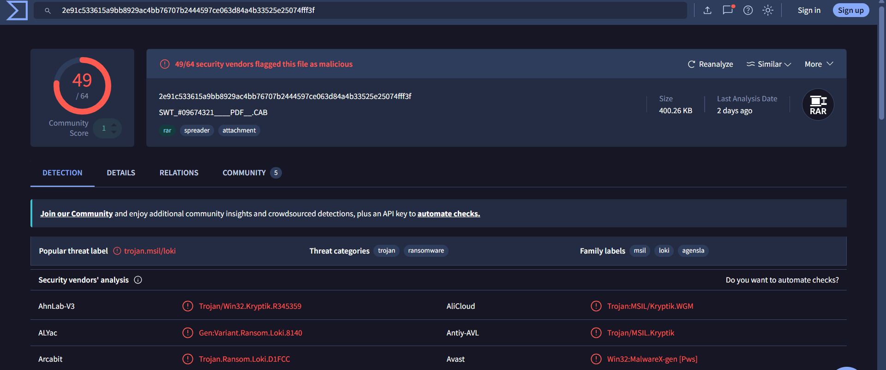

*Figure 10: VirusTotal reporting 49 detections out of 64 security vendors for the investigated attachment.*

### Analyst Assessment

**Verdict: Malicious attachment — high confidence based on the available reputation evidence.**

Supporting evidence:

- High security-vendor detection ratio
- Malware-related detection labels
- Suspicious attachment type
- Phishing-themed delivery context

The detection labels were reported by VirusTotal vendors. They should not be interpreted as an independently confirmed malware-family identification.

### Recommended SOC Response

- Quarantine the suspicious email.
- Search for other recipients of the same attachment.
- Check whether users downloaded or executed the file.
- Investigate endpoints associated with possible execution.
- Record relevant hashes and indicators.
- Escalate confirmed compromise evidence.

These are recommended analyst actions rather than remediation activities performed in the lab.

---

# 🎯 6. Practical Challenge — Snapped Phish-ing Line

**TryHackMe Room:** Snapped Phish-ing Line  
**Investigation Focus:** Phishing infrastructure and phishing kit analysis

## Scenario

This challenge involved examining suspicious phishing infrastructure and an associated archive.

A phishing kit can contain website templates, scripts, resources, and configuration files used to support fraudulent webpages or credential-harvesting attacks.

## 6.1 Suspicious Infrastructure

During the lab, I encountered phishing-related infrastructure associated with:

`kennaroaads[.]buzz`

The domain is defanged for safer documentation.

## 6.2 Archive Investigation

The investigated archive was named:

`Update365.zip`

A SHA-256 hash can be calculated using the Linux command:

```bash
cd ~/Downloads
sha256sum Update365.zip
```

SHA-256 creates a reproducible cryptographic fingerprint of a file.

File hashes help analysts search for previously investigated samples and correlate artifacts across cases.

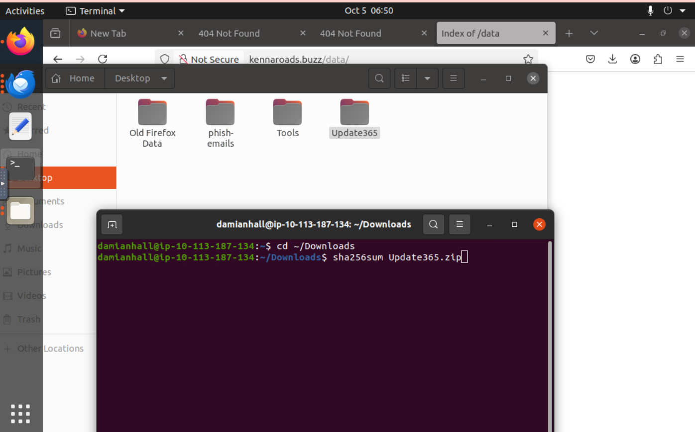

*Figure 11: Preparing to calculate the SHA-256 hash of Update365.zip inside the TryHackMe environment.*

**Evidence limitation:** The saved screenshot captures the command before execution. The actual resulting hash is not displayed and therefore is not claimed here.

### Investigation Methodology

1. Identify the suspicious website or domain.
2. Record the domain in defanged form.
3. Identify the phishing kit archive.
4. Calculate the archive hash.
5. Review available reputation results.
6. Examine relevant archive metadata.
7. Record confirmed findings.

### SOC Takeaway

Investigating phishing requires understanding relationships between:

**Email → Suspicious Link → Website → Infrastructure → Phishing Kit → Potential Credential Theft**

The broader investigation can reveal indicators useful for blocking, hunting, and incident response.

---

# 🧠 7. SOC Phishing Investigation Workflow

The module helped me develop a structured approach to phishing triage.

| Investigation Stage | Analyst Activities |
|---|---|
| Initial Triage | Examine the reported email and preserve available evidence |
| Header Analysis | Investigate sender identity, Return-Path, and authentication |
| IOC Extraction | Identify suspicious URLs, domains, IP addresses, and hashes |
| Threat Intelligence | Perform reputation checks and infrastructure enrichment |
| Malware Analysis | Review relevant static and sandbox analysis |
| Evidence Correlation | Compare findings and identify relationships |
| Classification | Determine whether the activity is benign, suspicious, or malicious |
| Reporting | Document findings, confidence, and recommended response |

### Main Lessons Learned

**1. Sender authenticity requires verification.**  
A familiar display name or company logo does not establish that an email is trustworthy.

**2. Detection results have limitations.**  
A zero-detection file can still require investigation, especially when content cannot be fully inspected.

**3. Threat intelligence requires context.**  
An IP reputation warning or malware label should be interpreted alongside other evidence.

**4. Dynamic analysis provides behavioral visibility.**  
Process execution and network activity can reveal suspicious behavior not visible from metadata alone.

**5. Network investigations support email security analysis.**  
SMTP traffic and TCP streams can provide useful evidence about message delivery.

**6. Structured reporting improves investigations.**  
Separating observations, interpretations, and recommended actions helps produce more defensible conclusions.

---

# 🧩 8. Skills Developed

### Email Security
- Email header analysis
- MIME and attachment inspection
- SPF, DKIM, and DMARC
- Phishing and impersonation indicators

### Threat Intelligence
- VirusTotal file reputation
- IP address enrichment
- IOC identification
- Threat indicator correlation

### Malware Investigation
- Suspicious attachment investigation
- Sandbox report interpretation
- Process and network behavior review
- Exploit-related analysis

### Network Analysis
- Wireshark packet inspection
- SMTP response interpretation
- TCP stream reconstruction
- Email delivery analysis

### Investigation Practices
- Evidence-based triage
- Technical documentation
- Threat classification
- Recommended response and escalation

---

# 🚀 9. Future Hands-On Projects

My next objective is to extend these phishing investigation skills into SIEM-based security operations.

### Microsoft Sentinel

I plan to document investigations separately, focusing on:

- Security alert triage
- KQL log queries
- Entity investigation
- Evidence correlation
- Incident assessment and reporting

### Splunk

I also plan to develop practical security investigations involving:

- SPL queries
- Security log analysis
- Event correlation
- Suspicious activity identification
- Alert investigation documentation

These projects will be maintained separately from this phishing analysis module.

---

## 📚 References

- [TryHackMe](https://tryhackme.com/)
- [VirusTotal](https://www.virustotal.com/)
- [IPinfo](https://ipinfo.io/)
- [ANY.RUN](https://any.run/)
- [PhishTool](https://www.phishtool.com/)
- [Wireshark](https://www.wireshark.org/)
- [MITRE ATT&CK](https://attack.mitre.org/)

---

**Author:** [Shahd Tamee](https://github.com/shahdtamee)  
**Path:** TryHackMe SOC Level 1  
**Focus:** Blue Team | SOC Analysis | Phishing Investigation
